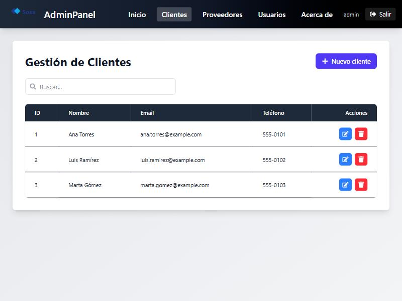

# AdminPanel

[](https://github.com/SrNe0/AdminPanel/actions/workflows/ci.yml)
[](https://admin.srne0.dev)
[](LICENSE)


Panel administrativo de demostración para gestionar **clientes**, **proveedores** y **usuarios**, construido con React, Vite y Tailwind CSS. Es un proyecto de portafolio frontend: no requiere backend, los datos se guardan en el navegador.



## Características

- **Autenticación simulada** con sesión persistente y rutas protegidas (`ProtectedRoute`); cerrar sesión la elimina de verdad.
- **CRUD completo** de clientes, proveedores y usuarios: crear, editar y eliminar con confirmación.
- **Validación de formularios** (campos obligatorios y formato de correo).
- **Búsqueda en tiempo real** en cada tabla.
- **Dashboard** con contadores calculados a partir de los datos reales.
- **Persistencia en `localStorage`** con datos de ejemplo iniciales.
- **Diseño responsive** con menú móvil y tablas con scroll horizontal.
- **Accesibilidad básica**: etiquetas en formularios, `aria-label` en botones de icono, cierre de modales con `Esc`.
- **Integración continua** con GitHub Actions (lint, pruebas y build).

## Demo rápida

1. Ejecuta el proyecto (ver abajo) y abre `http://localhost:5173`.
2. Inicia sesión con las credenciales de demostración:

   | Usuario | Contraseña |
   | ------- | ---------- |
   | `admin` | `admin123` |

## Instalación

Requiere [Node.js](https://nodejs.org/) 20 o superior.

```bash
git clone https://github.com/SrNe0/AdminPanel.git
cd AdminPanel
npm install
npm run dev
```

## Scripts

| Comando           | Descripción                          |
| ----------------- | ------------------------------------ |
| `npm run dev`     | Servidor de desarrollo con HMR       |
| `npm run build`   | Build de producción en `dist/`       |
| `npm run preview` | Sirve el build localmente            |
| `npm run lint`    | Analiza el código con ESLint         |
| `npm test`        | Ejecuta las pruebas con Vitest       |

## Estructura del proyecto

```
src/
├── assets/        # Logo y recursos estáticos
├── components/    # Layout, Navbar, Login, Modal, ResourcePage, ResourceForm, ProtectedRoute
├── context/       # AuthContext (sesión) y DataContext (datos + persistencia)
├── data/          # Datos de ejemplo y credenciales de demostración
├── lib/           # Lógica pura del CRUD (con pruebas) y acceso a localStorage
├── pages/         # Home, Clientes, Proveedores, Usuarios, About
├── App.jsx        # Definición de rutas
└── main.jsx       # Punto de entrada
```

`ResourcePage` es un componente genérico configurado por columnas y campos, de modo que cada módulo (clientes, proveedores, usuarios) se define con unas pocas líneas.

## Tecnologías

- [React 19](https://react.dev/) y [React Router 7](https://reactrouter.com/)
- [Vite 6](https://vite.dev/)
- [Tailwind CSS 4](https://tailwindcss.com/)
- [React Icons](https://react-icons.github.io/react-icons/)
- [Vitest](https://vitest.dev/) y [ESLint](https://eslint.org/)

## Limitaciones y próximos pasos

- La autenticación es solo de demostración; no debe usarse en producción.
- Los datos viven en el navegador. Un siguiente paso natural es conectar una API REST.
- Posibles mejoras: paginación, ordenamiento por columnas, pruebas de componentes y despliegue en GitHub Pages.

## Autor

**Diego Medina** — [@SrNe0](https://github.com/SrNe0)

## Licencia

Distribuido bajo la licencia MIT. Consulta el archivo [LICENSE](LICENSE) para más información.
